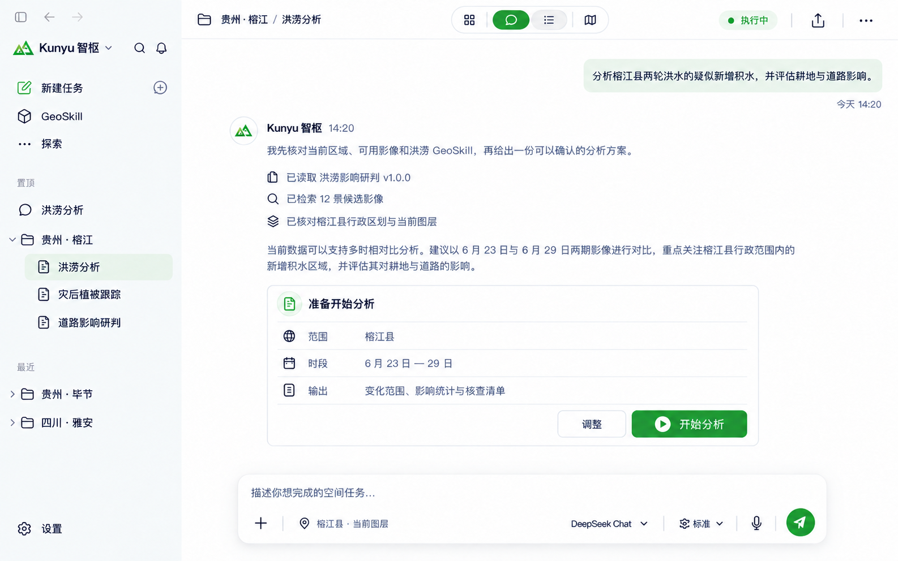
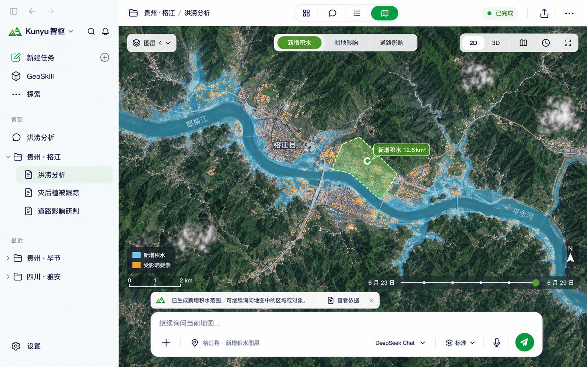

<!-- markdownlint-disable -->

<div align="center">


# 坤舆智枢 Kunyu GeoAgent

面向灾害遥感监测与研判的桌面智能体工作区<br>
基于 OGE 构建

[反馈问题](https://github.com/haodijia/kunyu-geoagent/issues) · [架构设计](./docs/开发架构设计.md) · [代码组织与维护](./docs/develop/代码组织与维护.md) · [提示词编辑入口](./backend/src/kunyu/agent/prompts/README.md) · [工作区文件存储](./docs/develop/工作区文件存储.md)

[](LICENSE)

<br>


<br>


</div>

<!-- markdownlint-restore -->

---

## 为什么选择坤舆智枢

灾害研判通常需要在有限时间内完成遥感数据发现、空间分析、结果核查和报告整理，流程横跨多种工具，也依赖较强的专业经验。坤舆智枢将自然语言交互、场景方法和 OGE 地理空间计算组织在同一个任务会话中，让复杂的研判过程更容易使用、复核和追溯。

项目目前处于设计与开发阶段，首期围绕“榕江县洪涝影响研判”打通完整业务链路。

## 本地开发

首次运行前安装各子工程依赖：

```bash
npm install --prefix electron
npm install --prefix frontend
uv sync --project backend
```

Electron 二进制默认从 npmmirror 下载，避免无法连接 GitHub 时安装失败；镜像地址配置在 `electron/.npmrc`。

数据库统一由 `backend/src/kunyu/persistence/schema.sql` 初始化，版本保存在 SQLite `user_version`，不再运行 Alembic 迁移链。旧开发库不会自动升级或删除；保留备份后使用新的 `KUNYU_APP_DATA_DIR`，或由开发者显式升级数据库。当前基线为版本 5，含模型、会话日志、审批、MCP、OAuth、子任务、分析成果和地图共 25 张表。

旧版本 4 的本机开发数据在应用关闭后显式迁到独立业务目录：

```bash
uv run --project backend python scripts/upgrade_workspace_storage.py "/原 Electron 运行目录" "/新的空业务目录" --switch-desktop
```

该命令从统一 SQL 基线升级成果归属、迁移工作区成果与附件、将 OGE 登录状态入库，校验后更新桌面目录设置。原目录完整保留；未登记的旧成果和开发录制文件不导入新业务目录。更早的开发库需要单独整理，不提供运行时兼容路径。

设置 → 数据与存储支持选择空目录、迁移现有业务数据并切换；Electron 缓存与界面运行状态始终留在独立运行目录。新安装的默认业务目录为系统应用数据目录下的 `Kunyu`，桌面运行目录为 `kunyu-electron`。用户级技能存在时保存于业务目录 `skills/`；工作区文件、附件和成果保存于 `workspaces/<workspace_id>/`。

在项目根目录用一条命令启动 Vite、Electron 和由 Electron 管理的 FastAPI：

```bash
npm run dev
```

关闭 Electron 窗口或终止该命令时，开发服务会统一退出。

Electron 自动向后端注入随应用安装的 `@vscode/ripgrep` 路径。单独启动后端时显式指定同一二进制，不使用系统 `rg`：

```bash
export KUNYU_RIPGREP_PATH="$(node --input-type=module -e 'import {rgPath} from "./electron/node_modules/@vscode/ripgrep/lib/index.js"; console.log(rgPath)')"
uv run --project backend python -m kunyu.main
```

Agent 系统提示词可直接编辑 [system.md](backend/src/kunyu/agent/prompts/system.md)，下一次模型请求生效。记忆工具及上下文代码入口见[记忆工具与上下文](docs/develop/记忆工具与上下文.md)，目录职责及 Tool、Skill 扩展约定见[后端 Agent 结构](docs/develop/后端Agent结构.md)。

Agent 可通过 `map_present` 主动展示卫星影像候选，在地图中选择并继续同一会话。地图消息逐行渐隐，完整对话、审批及后台任务状态始终可访问。

OGE 分析使用三个通用工具：`oge_search_operators` 检索实际算子目录，`oge_get_operator_definition` 查询参数与示例，`oge_execute_code` 编写并执行可组合的 Python 算子链。后端校验所选影像，调用原生 JWT 编译与批计算接口，保存任务身份，再下载保留数值的 GeoTIFF。每次调用导出一个栅格，支持单波段数值或三波段 uint8 RGB 上图；不再使用专用 NDVI GP 工具和录制运行模式。

代码工具提交后前台等待 120 秒，到期返回同一后台 job；后续沿用 harness 的 `job_output` 和完成通知，远端持续计算，不重复提交。成果由 Agent 调用 `map_present` 上图。协议、限制与验收见 [OGE 代码工具](docs/develop/OGE代码工具.md)，地图流程见[地图会话交互设计](docs/develop/地图会话交互设计.md)。

模型图片输入默认值、设置生效范围与各供应商官方指南见[模型图片输入](docs/develop/模型图片输入.md)。

在「设置 → 技能」中新建或导入 `SKILL.md` 技能包。会话中使用 `/技能名` 显式调用，或由模型按任务简介加载；支持 `whenToUse` 适用场景检索，已加载指令以 Markdown 快照展示；内置 `/disaster-assessment` 灾害研判技能。格式、权限、资源读取和来源优先级见[Agent 技能](docs/develop/Agent技能.md)。

## 功能特点

- **Workspace 与任务会话** — 一次请求、方案确认、工具执行、结果解释和成果导出都保留在同一会话中

  

- **地图研判** — 在全幅 GIS 工作区中查看图层、统计结果和空间对象，并将地图选择带回智能体上下文

  当前地图使用 MapLibre GL JS，接入 OpenFreeMap 矢量底图和 Mapterhorn 真实地形，支持二维／三维切换、浅色／深色主题、缩放、指北和返回榕江。业务图层尚待接入，服务配置及状态边界见[地图服务](docs/develop/地图服务.md)。

  

- **对话附件** — 支持拖拽、粘贴、图片预览、文件下载和带附件的发送队列；图片输入需按模型显式开启，可配置像素预算与请求字节上限，整次超限时持久记录历史图片省略并自动续跑；`read_image` 按路径读取工作区图片、图片文件附件及已省略图片，持久保存工具来源与坐标缩放说明；对话和轨迹的图片结果可直接打开居中预览与缩放弹窗；`read` 按路径、行号读取 UTF-8 附件与工作区文件，对话卡片和轨迹详情显示实际行号与续读位置。
- **多模型连接** — 保留 Chat Completions 接入 Kimi、Xiaomi MiMo、智谱 GLM、OpenAI 和兼容服务；MiMo 使用官方输出参数，国内智谱与 Z.AI 分开配置。
- **上下文压缩** — 手动 `/compact` 与步骤间自动压缩复用实际模型、思考参数、系统提示和工具定义，留下最近上下文及完整工具批次；供应商明确报上下文溢出时，成功缩减历史后才重建请求并有限重试。轨迹区分触发来源并保存实际输入、输出流和用量，失败／取消保留历史。自动压力判断需声明有效窗口，计数仍为估算。
- **上下文用量** — 输入区圆环与浮层显示最近实际请求的 token、模型窗口和缓存统计；未知窗口显示空心圆环，无用量时不虚构计数，压缩后提示等待下一次请求更新。
- **模型参数** — 按模型设置上下文窗口、最大输出、最近上下文保留预算、思考档位／请求值映射及图片输入；连接检查使用默认档位，运行与历史压缩使用已冻结的实际参数。
- **统一模型接口** — Agent 共用 LLM 服务，提供方插件负责准备和发现，SDK 负责协议。DeepSeek 使用 Messages，OpenAI 使用 Responses，Kimi／MiMo／GLM 使用兼容 API；自定义连接可明确选择支持的 API。签名、加密推理、工具与图片续接由原生 SDK 状态保存。
- **多 Agent 委派** — 一层只读子任务使用独立历史、父模型快照和继承的插件作用域；支持等待、后台启动、取消及完整报告分页。对话卡片可查看子对话、工具与轨迹，父任务停止和关闭清理孩子，重启不重复已开始的调用。
- **任务进度** — Agent 通过 `todo_write` 更新完整任务计划，对话输入框上方显示当前轮次进度，刷新后可恢复。
- **工具展示** — 对话使用紧凑标题行，耗时显示在右侧；展开后优先展示文件列表、带行号文本和图片结果，调用参数单独折叠。对话与轨迹复用结果卡片，图片显示缩略图、尺寸、格式和大小。
- **工具审批** — 本地记忆写入在批准事务中落盘；异步业务工具可声明精确审批绑定，批准后进入 Agent 队列执行。目标或权限变化会拒绝调用，已开始后中断的调用不会在续跑时自动重发。
- **用户提问** — `ask_user_question` 接管输入区，支持逐题单选、多选、补充文字和跳过；回答草稿随窗口刷新恢复。关闭返回工具取消结果，停止运行取消问题；等待释放执行槽且不计活动预算，回答后继续原工具批次。
- **计划模式** — `/plan [计划需求]` 进入、`/plan off` 退出；输入区显示可点击退出的计划标记。运行中的切换在下一个接受的模型步骤生效，当前工具批次保持原权限；待生效选择随会话日志恢复，退出标记保留输入草稿。`exit_plan_mode` 提交完整 Markdown 计划，输入区审批、右侧阅读全文；批准在下一接受步骤退出，修改计划恢复输入区，历史计划可重新打开。
- **工作区文件** — `write` 创建或替换文本文件，`edit` 做精确文本替换；覆盖与编辑校验本会话已读取的文件版本。对话和轨迹展示实际应用的上下文 diff 与增删行数，计划／只读模式禁止写入。
- **OGE 数据接入** — 在「设置 → OGE 平台」管理账号登录与退出；Agent 可直接查询行政区、检索卫星影像、读取详情和查看预览。工具按文件操作、上下文、工作流和 OGE 平台分类，见 [OGE 平台接入](docs/develop/OGE平台接入.md)。
- **文件搜索** — `glob` 查找文件，`grep` 使用 ripgrep 正则定位内容；对话和轨迹显示文件列表与实际匹配行号。超过上限时保存完整结果，Agent 可用 `read` 续读，再读取目标文件并编辑。

- **可追溯成果** — 将地图、指标、任务详情、核查清单和报告组织为可定位来源与计算过程的业务成果

## 应用场景

- 洪涝、森林火灾、地震与地质灾害等事件的遥感研判
- 灾前背景分析、灾中动态监测与灾后影响评估
- 应急制图、空间信息查询与辅助决策
- 遥感与地理信息教学、演示及科研实验

## Star History

[](https://star-history.com/#haodijia/kunyu-geoagent&Date)

## 🌟 贡献者

[](https://github.com/haodijia/kunyu-geoagent/graphs/contributors)

## 许可证

[Apache License 2.0](LICENSE)
