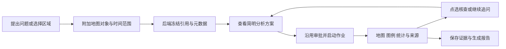

# 地图 + Agent 产品调研及坤舆开发建议

调研日期：2026-10-15。范围：空间分析工作台、地图与 Agent 的交互契约，以及与当前坤舆实现的适配。通过 AI 辅助检索官方文档、发布记录和公开源码，并静态审查本项目及本地 Mu、deepseek-harness；未登录竞品实测，未调用真实 OGE 计算。产品能力与发布状态按来源记录，优先级和适配判断是本次分析建议。

## 1. 建议方向

继续沿用 **MapLibre + 现有 Python Agent + OGE + 持久任务与成果**。体验重点参考 Felt，服务封装参考 CARTO，专业分析的计划与来源展示参考 Google Earth AI，浏览器实时地图读取参考 opengeos/GeoAgent。

按本地 deepseek-harness 的实际机制补齐：新会话提问 → Agent 检索 → 显式调用地图展示工具供选景 → 地图内回复并计算 → 工具登记通用 job，等待到期返回 job ID 与当前状态 → 模型通过 `job_output` 读取或限时等待；完成时向忙碌 Agent 注入 notice，默认唤醒空闲 Agent → Agent 用展示工具上图 → 地图内继续对话。2026-10-16 已实现通用 jobs、OGE 生产者、map_present、候选选择和地图轻会话；真实所选影像 NDVI 尚未接通。实现、源码依据及本地夹具/真实服务验收边界见 [地图会话交互设计](/Users/dijkstra/project/01-python/kunyu-geoagent/docs/develop/地图会话交互设计.md:1)。结构化引用、AOI 和数值分析作为支撑能力逐步接入。现有 Agent、审批、轨迹、地图持久化均应复用，依据见第 4 节。

这里用五项标准判断交互是否值得借鉴：空间范围明确、步骤可检查、结果能继续操作、修改影响可解释、来源能追溯。公开演示的视觉表现不能证明分析准确率或生产稳定性。

## 2. 商业产品：分别借鉴什么

| 产品 | 已核实的能力与交互 | 状态与对坤舆的价值判断 |
| --- | --- | --- |
| **Felt AI** | `@` 引用图层或数据源，选中多边形后提问；执行步骤可展开查看 SQL；分析结果进入图层、统计卡和筛选器。2026-09-15 增加分区统计、栅格波段、剖面和矢栅采样。[助手文档](https://help.felt.com/felt-ai/ai-assistant)、[栅格发布](https://felt.com/blog/raster-analysis) | 已有商业产品和操作文档；**最优先参考地图交互**。内置 AI 与外部 MCP 能力不同，MCP 当前不能创建仪表板组件；部署和使用受套餐约束。[MCP 边界](https://help.felt.com/felt-ai/mcp)、[当前方案](https://felt.com/pricing) |
| **CARTO Agentic GIS** | 地图内 Agent 结合指令、数据语义和工具开展分析；参数化 Workflows 可发布为 MCP 工具。2026-10-07 更新支持工具改变数据后刷新地图、表格和指标。[Agent 文档](https://docs.carto.com/carto-user-manual/ai-agents)、[Workflow 工具](https://docs.carto.com/carto-user-manual/workflows/workflows-as-mcp-tools)、[发布记录](https://docs.carto.com/whats-new) | 已有正式产品；**优先参考服务契约和业务语义**。把经过验证的分析方法交给 Agent 调用，避免每次自由拼算法。商业平台、开放协议和开源 SDK 应分别看待。 |
| **Google Earth AI / Ask Google Earth** | 可引用项目中的点、多边形和显式附加的当前视野，结果组织为地图文件夹。2026-10-14 公布的 Geospatial Reasoning agent 强调先规划、按需调用专业 skills、在独立空间工作区处理数据并展示来源。[Ask Earth 文档](https://developers.google.com/maps/documentation/earth/gemini/get-started)、[10 月 14 日更新](https://research.google/blog/putting-earth-ai-to-work-geospatial-agents-for-our-planets-biggest-challenges/) | Ask Earth 标为 Experimental；新深度分析和 A2A 仍为有限早期访问。**参考复杂遥感任务的规划与证据展示**；不能当作已可自由集成的成熟开源框架。[访问状态](https://sites.research.google/gr/geospatial-reasoning/) |
| **Atlas Navi** | 对话生成地图、仪表板和多步空间工作流；生成的步骤可在画布中检查和修改，官网展示调度与报告。[Navi 发布](https://atlas.co/blog/introducing-navi-ai-that-builds-maps-from-conversation/)、[当前官网](https://atlas.co/) | 已公开提供产品，未核实每项调度能力的套餐及遥感处理边界。**中期参考专家接管和流程编辑**；当前无需先建设通用工作流画布。 |
| **FSQ Spatial Agent** | 问题进入数据选择、空间 SQL、地图与图表流程，SQL 和中间结果可检查、修改。2026-02-11 官方公告发布到 Spatial Desktop。[发布说明](https://foursquare.com/resources/blog/ad-tech/introducing-fsq-spatial-agent-your-geospatial-ai-analyst/)、[Desktop 文档](https://docs.foursquare.com/analytics-products/docs/fsq-spatial-desktop-getting-started) | 公告中的 Workbench 仍为 coming soon，本次未查到更晚确认。**参考分析师查看中间数据和计算方法的路径**；不能据此认定已覆盖遥感预处理和时序。 |
| **Aino** | 从地点或问题形成空间分析、地图和项目成果；官方展示可复用的方法与数据来源目录。[产品](https://www.aino.world/)、[数据目录](https://www.aino.world/data)、[可复用流程](https://www.aino.world/6month) | 商业产品，偏城市规划与选址。**参考 AOI、来源、历史分析在项目中持续沉淀**。本次未核实全部企业功能和自部署能力。 |
| **ArcGIS Location Services MCP** | 官方托管 MCP 提供地理编码、路线、高程和静态地图等能力。[官方文档](https://developers.arcgis.com/ai/mcp-arcgis-location-services/) | 明确标为 beta。**外部地理服务接入参考**；调用地理 API 与读取、控制坤舆当前 MapLibre 画布是不同能力。 |

### Felt 最值得拆解的交互

1. **对象进入输入框。** 用户通过 `@` 指定图层，或选择手画多边形，再用自然语言提问；步骤展开后可以检查具体查询。对话随地图保存。[官方助手文档](https://help.felt.com/felt-ai/ai-assistant)
2. **指标绑定明确输入。** 栅格采样选择波段、统计量与矢量区域；统计卡和筛选组件属于具体图层。“按当前视野统计”是可选配置，范围变化是否改变数值可由用户控制。[空间分析](https://help.felt.com/analysis-and-dashboards/spatial-analysis)、[仪表板](https://help.felt.com/analysis-and-dashboards/dashboards)
3. **视图过滤与生成成果有区别。** 空间过滤可联动更新区域统计，但不等于生成新的持久裁剪栅格；导出裁剪 GeoTIFF 是独立操作。派生分析图层也不会自动随输入变化更新，需明确重跑。[栅格发布](https://felt.com/blog/raster-analysis)、[空间分析](https://help.felt.com/analysis-and-dashboards/spatial-analysis)、[助手限制](https://help.felt.com/felt-ai/ai-assistant)

对坤舆的取舍：地图选择应形成可见引用；每个统计数值应有绑定的范围和来源；输入变化后保留旧成果并提示重算。具体行为应由坤舆的成果模型定义，不必照搬竞品的更新或撤销限制。

## 3. 开源框架与组件：能复用到哪一层

| 项目 | 已核实的架构与许可 | 建议 |
| --- | --- | --- |
| **[opengeos/GeoAgent](https://github.com/opengeos/GeoAgent)** | MIT，基于 Strands；提供 Python/FastAPI 到浏览器 MapLibre 的双向 bridge。命令带 ID、sessionId 和 mapId，前端执行后返回匹配结果，断连和超时明确报错。[bridge 源码](https://raw.githubusercontent.com/opengeos/GeoAgent/main/geoagent/browser/session.py)、[TypeScript 示例](https://github.com/opengeos/GeoAgent/tree/main/examples/browser_maplibre_typescript) | **优先参考实时读取与执行回执**，用于当前可见要素、渲染状态、截图等能力。坤舆已具备 Agent 与持久地图变更通道，无需迁移到 Strands，也无需另建共享状态系统。 |
| **[ESIP MC² / MapControl](https://github.com/ESIPFed/mc2)** | Apache-2.0；FastAPI + REST/MCP + WebSocket + MapLibre，共享地图会话与空间资产。 | 参考 map session、asset、viewport 的职责划分。与当前持久地图重叠较多，且本次未做部署或稳定性验证，适合作为协议参考。 |
| **[Mapbox MCP Server](https://github.com/mapbox/mcp-server)** | MIT，官方项目；提供搜索、路线、等时圈等工具，支持 MCP Apps 交互地图及 GeoJSON。相关服务仍需 Mapbox 账户和用量。[官方文档](https://docs.mapbox.com/location-ai/mcp-servers/mcp-server/) | 后续按业务需要接入地理服务。它能生成交互地图，不能据此推断能操作坤舆现有地图或调用 OGE 分析。 |
| **[maplibre-mcp](https://github.com/birkskyum/maplibre-mcp)** | MIT，社区项目；主要覆盖样式验证、瓦片检查、图层诊断、预览及 MCP Apps 展示。 | 可用于开发诊断；公开工具表不足以证明它是任意现有业务地图的上下文桥。 |
| **[QGIS AI Agent / TerraLab](https://github.com/TerraLabAI/QGIS_AI-Agent)** | 插件 GPL-2.0-or-later；当前项目对话可附加图层、选择集和地图视图。Agent 后端、系统提示等不在公开插件仓库。 | 参考“附加地图对象到消息”的流程；不能当作完整自托管开源 Agent 底座直接引入 Electron 项目。 |
| **[Terra Draw](https://github.com/JamesLMilner/terra-draw)** | MIT；官方 MapLibre adapter 提供多边形、矩形和选择编辑等能力。支持矩阵目前列 MapLibre v4/v5。 | **AOI 绘制的优先评估对象**。本项目使用 MapLibre 6.14.0，必须先验证当前版本兼容性，本次未安装运行，不能承诺即插即用。[项目依赖](/Users/dijkstra/project/01-python/kunyu-geoagent/frontend/package.json:1) |

deck.gl 可在未来有大规模点、轨迹或聚合显示需求时评估；它是渲染组件，不能补齐对象引用和任务编排。[官方交互文档](https://deck.gl/docs/developer-guide/interactivity)

框架选择结论：目前最有价值的复用是绘制组件和交互契约。现有 Agent 已实现持久执行、审批、恢复与事件流，暂时没有引入另一套 Agent runtime 或前后端事件协议的明确需求，依据见下一节。

## 4. 坤舆现状：以源码为准

| 能力 | 实际状态 | 代码依据 |
| --- | --- | --- |
| 地图工作区 | MapLibre 2D/3D、主题、地形、业务栅格、图层顺序/显隐/透明度已实现 | [地图入口](/Users/dijkstra/project/01-python/kunyu-geoagent/frontend/src/features/sessions/views/MapView.tsx:69)、[栅格图层](/Users/dijkstra/project/01-python/kunyu-geoagent/frontend/src/features/maps/useAnalysisLayers.ts:34) |
| 地图持久化 | 视角、图层、选中成果与 revision 冲突校验已实现 | [MapRepository](/Users/dijkstra/project/01-python/kunyu-geoagent/backend/src/kunyu/persistence/maps.py:26) |
| Agent 与计算 | 工具、审批、计划、问题、多 Agent、日志和轨迹已有；NDVI 登记作业，后台监督并收集成果 | [组合入口](/Users/dijkstra/project/01-python/kunyu-geoagent/backend/src/kunyu/agent/bootstrap.py:93)、[监督器](/Users/dijkstra/project/01-python/kunyu-geoagent/backend/src/kunyu/application/analysis_supervisor.py:15)、[轨迹](/Users/dijkstra/project/01-python/kunyu-geoagent/frontend/src/features/sessions/views/TraceView.tsx:21) |
| 当前 NDVI 输入 | 明确传入候选集/影像引用，冻结 coverageID/productID；现有 GP 首版支持 LC08_C02_L1 | [NdviArguments](/Users/dijkstra/project/01-python/kunyu-geoagent/backend/src/kunyu/agent/tools/oge/ndvi.py:11)、[提交契约](/Users/dijkstra/project/01-python/kunyu-geoagent/backend/src/kunyu/integrations/oge/execution.py:96) |
| 当前 NDVI 输出 | `rgb_raster` 显示影像，明确不具备数值 NDVI；默认 live，replay 需显式设置 | [成果类型](/Users/dijkstra/project/01-python/kunyu-geoagent/backend/src/kunyu/domain/analysis.py:48)、[栅格元数据](/Users/dijkstra/project/01-python/kunyu-geoagent/backend/src/kunyu/integrations/analysis_raster.py:44)、[运行模式](/Users/dijkstra/project/01-python/kunyu-geoagent/backend/src/kunyu/integrations/oge/execution.py:31) |
| 地图进入对话 | 成果引用复用现有入口；影像选择带候选集和 imageId 随消息冻结，对话与地图共享对象标签 | [成果引用按钮](/Users/dijkstra/project/01-python/kunyu-geoagent/frontend/src/features/analysis/OutputCard.tsx:66)、[旧地图上下文](/Users/dijkstra/project/01-python/kunyu-geoagent/frontend/src/features/sessions/map-context.ts:34) |
| 提交时与实时上下文 | 消息受理校验 workspace 与候选归属，步骤上下文注入冻结影像引用；地图工具读取实时状态并显式展示 | [受理校验](/Users/dijkstra/project/01-python/kunyu-geoagent/backend/src/kunyu/persistence/run_acceptance.py:154)、[消息组装](/Users/dijkstra/project/01-python/kunyu-geoagent/backend/src/kunyu/agent/context.py:71)、[地图工具](/Users/dijkstra/project/01-python/kunyu-geoagent/backend/src/kunyu/agent/tools/maps/tools.py:80) |
| 数据发现 | 已有行政区和影像搜索；检索参数支持行政区、多边形、bbox，不代表计算服务已支持裁剪 | [影像搜索](/Users/dijkstra/project/01-python/kunyu-geoagent/backend/src/kunyu/agent/tools/oge/search_images.py:20)、[检索参数](/Users/dijkstra/project/01-python/kunyu-geoagent/backend/src/kunyu/agent/tools/oge/arguments.py:80) |

因此当前缺口是从“默认样例可上图”到“按用户选择开展可核查分析”。不能把 AOI 字段的存在当作功能完成，也不能从 RGB 预览推算 NDVI、阈值或受淹面积。

部分早期文档仍写“业务图层未接入”；本次判断采用实际源码以及 [Agent 与地图协同设计](/Users/dijkstra/project/01-python/kunyu-geoagent/docs/develop/Agent与地图协同设计.md:1) 中后续实现记录。

## 5. 建议的交互闭环

以下为能力组合示意，尚未全部实现。实际交互与异步工具循环以用户最后确认方向的 [地图会话交互设计](/Users/dijkstra/project/01-python/kunyu-geoagent/docs/develop/地图会话交互设计.md:1) 为准。用户既可以先提问，也可以先选区；缺少必要参数时再补充。

| 环节 | 用户看到什么 | 实现约束 |
| --- | --- | --- |
| 指定对象 | 输入框上方显示可删除标签，如“榕江研究区 v2”“灾前影像”“分析成果”；点击标签可定位 | 先完成已有成果引用，再扩展 AOI 和影像；后端校验会话归属、revision 并冻结元数据，明确送入模型 |
| 数据选择 | 地图显示候选影像覆盖范围，卡片显示产品、时间、分辨率、可用波段等已知信息 | 已选影像必须能映射到计算服务输入；未验证时明确不可运行，不暗中使用默认影像 |
| 分析方案 | 简明展示区域、输入、方法、预期成果；缺项就地补齐 | 多步或有计算成本的任务复用已有计划/审批。定位、显隐、透明度保持轻量操作；不增加每步审批 |
| 执行反馈 | 对齐 harness jobs：登记任务、返回 job ID，模型通过 `job_output` 读取或限时等待 | 不新增 NDVI 专用等待流程；等待到期仍运行就返回 running；完成通知向 busy owner inject、默认向 idle owner followup。成功后 Agent 显式调用展示工具 |
| 核查结果 | 图例、像元/图斑详情、统计卡与来源在同一任务中可达 | 数值来自真实波段或空间计算，标明 AOI、单位、有效覆盖和方法；视野范围与计算范围分别记录 |
| 后续修改 | 改配色立即更新展示；改 AOI、影像或算法生成新分析版本 | 旧成果保留原参数，标明与当前输入的关系；计算变更不伪装成单纯样式变更 |
| 交付 | 报告中的指标可定位到地图对象、输入和作业轨迹 | 文字引用结构化统计记录与成果 ID，不能只保存一段无法定位的摘要 |

布局上继续使用现有地图、Composer、任务/图层/详情和轨迹视图；在地图中增加可展开的本轮对话与结果区域，让用户核查时保留地图位置。基础组件与样式沿用 Mu 和现有 shadcn/ui。指标、结果卡和轨迹从同一作业/成果投影，避免各自维护运行状态。

这与本地参考已采用的模式一致：[Mu 样式](/Users/dijkstra/project/02-ts/mu/desktop/packages/desktop/src/renderer/styles/themes/mu-color-scheme.css:1)、[现有输入标签样式](/Users/dijkstra/project/01-python/kunyu-geoagent/frontend/src/styles/conversation.css:48)、[deepseek-harness 轨迹架构](/Users/dijkstra/project/02-ts/deepseek-harness/packages/client/ui-trajectory/README.md:54)。

## 6. 能力依赖与验收边界

以下为支撑地图会话闭环的能力依赖；交互实现顺序以用户补充后的 [地图会话交互设计](/Users/dijkstra/project/01-python/kunyu-geoagent/docs/develop/地图会话交互设计.md:1) 为准。

### 并行前置：验证 OGE 的真实输入和成果契约

应立即核对三件事：公开影像 ID 如何映射到服务参数；服务是否接受 AOI 及其真实含义；可取得哪种原始数值栅格或洪涝成果。形成一份脱敏、可重复读取的真实样例，再确定具体灾害算法与输出。现有默认 NDVI 接口不足以证明这些能力，不能等全部 AOI 界面完成后才验证。

本轮未发起此类真实联调；这是后续开发的外部依赖，不能用新造 mock 宣称核验成功。

### 第一阶段：已有成果的结构化引用

将当前文本 ID 改为可见标签及后端可解析引用，首轮只支持已有 `AnalysisOutput`。提交时完成归属、revision、元数据快照、持久记录和模型上下文注入；地图实时查询与本次输入快照分别表达。随业务接入逐步替换旧占位字段，保持一份明确的消息契约。

**验收：** 用户附加成果后，即使移动地图或切换选择，Agent 仍明确分析提交时那份成果；错误会话或版本被拒绝；历史消息能显示当时引用。使用现有 replay 成果即可完成本地手工验收。

### 第二阶段：AOI、时间与影像候选

先支持画框和已有行政区选择，再按需求增加多边形编辑。复用现有检索工具和数据层，增加候选卡、覆盖范围及确认选择。AOI 保存 GeoJSON、来源和整数 revision；检索范围、展示过滤、实际计算裁剪分别显示。绘制组件先完成 MapLibre 6 兼容性验证。

**验收：** 地图和输入标签显示同一 AOI、时间和影像；检索请求准确携带条件。几何、标签和候选交互可离线验证；行政区和公开影像返回需真实接口联调，计算输入映射与私有数据访问需相应有效账户。

### 第三阶段：一个有定量依据的分析成果

依据前置核验结果，先支持一种真实可得的数值栅格或矢量主成果，按实际需要派生其他形式。扩展现有 `AnalysisOutput`、地图图层与结果卡：栅格保存波段、NoData、scale/offset 和分辨率，支持像元采样；矢量保存几何、属性和指标定义，支持要素查询与面积统计。共同保留坐标系、参数和来源，配置对应的 AOI 统计与图例。

**验收：** 每个展示数值都能回到原始成果和统计范围；显示影像与数值产品明确区分。现有 RGB 回放不能作为数值分析验收材料。

### 第四阶段：完成一个榕江洪涝问题

建议将首个业务问题限定为：**给定 AOI 和两景可比的灾前灾后影像，识别新增水体，并输出面积、空间成果与核查依据。** 最终采用的方法和数据产品由真实服务能力决定。

依次补灾前灾后对比、结果核查、按真实数据可支持的区域统计、简报与轨迹回链。保留产品、日期、分辨率、处理方法和无效覆盖说明；新增水体、受淹范围与资产损失应使用各自准确的指标定义。

**验收：** 从选区、选景、计算到上图、核查、报告完整运行；刷新或重启后能够恢复任务和成果；报告数值可定位。固定样例可验证控件，真实案例完成情况需单独记录。

## 7. 下一次开发的具体范围

根据用户要求沿用原参考项目，优先交付 **“补齐 harness 的通用 jobs → Agent 显式地图展示工具 → 地图轻消息与选择 → 成果由 Agent 展示”**。移植 `jobs / jobs-local / tool-jobs` 的任务登记、输出读取、限时等待、完成通知和默认唤醒，OGE 接入已有 AnalysisJob 与监督器；不新增 `wait_task`。先以已有默认 NDVI 与录制成果验证视觉和时序，同时接入检索候选及真实对象引用，并核验 OGE 选景输入映射；不能用默认输入计算冒充所选影像计算。移除另造的定时调度、固定调用前提醒及自动导航/自动上图设想，完成送达遵循 harness 源码。

当前暂缓：新 Agent loop、通用 DAG 编辑器、插件市场、地图引擎替换，以及没有数值数据支撑的统计面板。这与项目 [当前开发目标](/Users/dijkstra/project/01-python/kunyu-geoagent/docs/develop/当前开发目标.md:3) 中完成通用底座后转向地理业务的方向一致。

调研阶段只新增本文档；后续开发记录见地图会话设计第 9 节。实现复用既有组件、统一类型与错误处理，保留单一 `schema.sql` 基线，以明确标注的本地夹具流程和真实联调分别记录验收证据。
