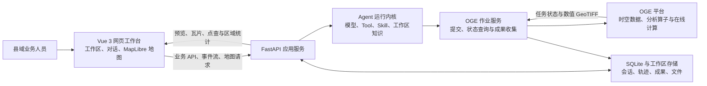
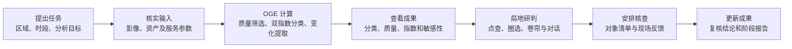

# 坤舆智枢｜灾害监测与研判 Agent 平台应用开发方案

第一届东方航天港杯开放地球引擎（OGE）应用创新大赛 · 赛道一 · 遥感应用案例

| 项目 | 内容 |
| --- | --- |
| 作品名称 | 坤舆智枢——基于 OGE 的灾害监测与研判 Agent 平台 |
| 示范案例 | 广西贵港郁江双期水体变化与洪涝研判 |
| 报名单位 | 【待填写】 |
| 团队成员 | 【待填写】 |
| 指导老师 | 【待填写】 |
| 队长及电话 | 【待填写】 |

## 一、作品概述

坤舆智枢面向县域应急、水利和农业农村业务，将卫星影像检索、水体变化提取、地图核查和研判记录组织在同一个网页工作区。用户用自然语言提出任务，Agent 按场景 Skill 查询数据、调用 OGE 算法服务并展示结果。用户可以在地图上点查像元、圈选河段统计面积，通过卷帘对照两期水体，再沿用原任务成果追问原因。平台据此形成可定位的巡查线索，后续接入耕地、道路和居民点数据，支持对象核查、反馈记录和阶段报告。

首个示范选取广西贵港郁江沿岸约 20 km × 20 km 的区域，采用 2026 年 6 月 22 日和 7 月 12 日两景 Sentinel‑2A L2A 影像。前一期作为灾前背景，后一期用于观察灾后或退水期水面。案例围绕水面在哪里扩张、哪些河段已经退水、哪些片区值得优先核查展开。两期观测日期与有效覆盖随图层和统计展示，供研判人员结合水情资料和现场记录判读。

首期交付物包括网页工作台、发布于 OGE 的双期水体变化服务、洪涝分析 Skill、郁江案例数据与成果，以及部署和操作说明。在此基础上建设承灾对象核查、多时相追踪和专题报告，使同一区域的新观测、复核记录与既有成果能够连续使用。

## 二、需求分析

### 2.1 用户与研判任务

| 用户 | 要解决的问题 | 所需成果 |
| --- | --- | --- |
| 县乡应急人员 | 哪些地方出现水面变化，应先核查哪些片区 | 变化专题图、观测质量图、可定位的核查清单 |
| 水利业务人员 | 河道及沿岸哪些位置持续有水、出现新增水体或已经退水 | 两期水体图、卷帘对照、河段圈选统计、关注点读数 |
| 农业农村业务人员 | 哪些耕地与新增水体重叠，哪些地块需要现场核实 | 地块重叠面积、乡镇汇总、地块位置和核查状态 |
| 遥感技术人员 | 数据能否比较，结果对参数有多敏感，后续如何复算 | 影像与资产目录、质量掩膜、指数与阈值敏感性图、作业及参数记录 |

### 2.2 业务需求

**找到可比较的观测。** 同一事件的影像可能覆盖不同河段，整景云量也不能代表关注区内的有效覆盖。工作台按行政区、几何范围、时间和产品筛选影像，结合场景分类掩膜检查两期观测质量，保存实际采集日期和分析覆盖。

**从区域概况追查到具体位置。** 用户先看新增、持续和退水的空间分布，再点查异常位置或圈出河段。地图把选点、选区和当前图层随问题提交，Agent 可直接回答“这一段新增了多少”“这个位置为什么是指数分歧”，并引用同一份栅格的质量和指数波段。

**把遥感变化转化为可执行的核查任务。** 将变化图斑与耕地、道路、居民点及设施关联，组织成带位置、来源、观测时间和核查要点的清单。后续影像与现场记录进入同一工作区，技术人员据此更新判断并保留历次成果。

## 三、功能设计

### 3.1 总体架构

- **网页工作台。** Vue 3、TypeScript 与 MapLibre GL 提供对话、运行轨迹和二维／三维地图。工作区管理资料、成果、记忆与规范，会话保存消息、运行及当前地图状态。同一工作区内的新会话可引用已有成果。
- **Agent 运行内核。** 模型负责理解意图、选用技能、组织步骤与解释成果。工具负责数据查询、计算、数值读取和空间统计。运行内核管理流式对话、计划、问答、工具审批、上下文压缩及运行事件，轨迹界面可查看调用参数、任务状态和结果。
- **业务与数据服务。** FastAPI 提供会话、任务、成果、地图和设置接口，统一管理 OGE 凭据、业务校验和结果收集。SQLite 保存结构化业务记录，工作区目录保存文件和原始成果。专题计算由 OGE 执行，平台基于原始栅格提供预览、瓦片、点查和区域统计。

### 3.2 从任务提出到核查反馈

以“分析贵港郁江这两期水体变化”为例，Agent 读取洪涝 Skill 和服务定义，明确默认影像日期，提交 OGE 作业并显示主分类图。用户沿河圈选后询问区内新增水体面积，可以继续切换到质量图和敏感性图查证。研判人员随后在关注点和承灾对象清单中记录核查结果。新观测到达后，平台以新的观测日期和成果版本更新事件研判。

### 3.3 功能组成

| 功能 | 使用方式与建设内容 |
| --- | --- |
| 工作区与资料 | 按区域或灾害事件建工作区，管理会话、影像说明、研究区文件、分析成果、工作区记忆和规范 |
| 数据检索与服务调用 | 查询 OGE 行政区、影像和个人数据，读取资产详情及服务参数。技术人员可调用已发布服务，或提交 OGE 算子脚本并声明结果波段与视图 |
| 任务执行与轨迹 | 在会话中显示计算进度、工具调用、作业回执与错误信息，计算结束后自动收集并登记成果 |
| 成果卡与地图 | 从成果卡切换变化、观测质量、指数、阈值敏感性等视图。支持原始 GeoTIFF 下载、图层管理、点查、矩形或多边形统计、GeoJSON 选区导入及卷帘 |
| 研判与成果跟踪 | 建设乡镇汇总、承灾对象叠加、巡查清单、现场核查回填和专题报告。接入新增观测后，以时间轴和动态图表展示变化过程 |
| 方法扩展 | 将数据选取、计算参数、成果图例和业务判读整理为 Skill、OGE 服务契约和案例。通过通用栅格模型接入植被指数、火烧迹地等新专题 |

## 四、开发方案

### 4.1 数据组织与质量检查

| 数据 | 用途 | 准备要求 |
| --- | --- | --- |
| 两期 Sentinel‑2A L2A 光学数据 | 从 B03、B08 提取 NDWI，保留可见光波段供判读 | 固定两期观测，记录来源、采集时间、空间范围和辐射处理 |
| 两期短波红外及 SCL | 从 B11 计算 MNDWI，用场景分类筛选可用像元 | 源网格为 20 m，与光学输入对齐至 10 m 分析网格 |
| 郁江关注点 ID 栅格及对应点位 | 查询点位处的变化类别，定位典型河段 | 与分析网格同原点、同范围，通过 ID 关联点位 |
| 乡镇边界、耕地、道路、居民点与设施 | 用于对象叠加、分区汇总和巡查调度 | 登记来源、版本、坐标系、使用许可和地物识别字段 |
| 后续 Sentinel‑1、DEM 与水文气象资料 | 补充云雨时段观测，辅助解释地形和水情 | 核查雷达轨道及覆盖、DEM 分辨率和水文气象资料的记录时刻 |

郁江示范的六份影像取自 Earth Search Sentinel‑2 L2A 公共 COG，裁剪后作为 OGE 个人数据使用。已核验输入范围、波段、对齐关系和像元值。分析网格采用 EPSG:32649、10 m。短波红外、SCL 与关注点 ID 使用最近邻对齐，判读仍遵循各输入的原始分辨率。该批影像的反射率偏移已经处理，脚本按 0.0001 比例恢复反射率。扩展到其他区域时，按数据产品重新核定缩放、偏移、投影和像元对齐。[Sentinel‑2 L2A 产品说明](https://documentation.dataspace.copernicus.eu/APIs/SentinelHub/Data/S2L2A.html) · [郁江数据核验记录](develop/贵港水体变化与研判.md)

### 4.2 OGE 双期水体变化计算

在 OGE 在线开发环境运行 [双期水体变化脚本](../services/oge/flood_monitoring.py)。脚本通过 OGE Coverage 算子完成波段选择、重投影、掩膜、指数计算、二值化、逻辑比较和波段合并。该算子链将两期输入、中间结果和专题输出编入同一次远端作业。

1. **筛选有效像元。** 使用 SCL 4、5、6，分别对应植被、裸地和水体。结合波段正值、分母和指数值域检查生成每期有效掩膜及共同有效范围。
2. **计算两种水体指数。** NDWI 使用绿光与近红外，MNDWI 使用绿光与短波红外。两种指数分别按 `(B03 − B08) / (B03 + B08)` 和 `(B03 − B11) / (B03 + B11)` 计算。默认阈值均为 0，高于阈值的像元获得相应指数的水体判定。[NDWI 原始论文](https://doi.org/10.1080/01431169608948714) · [MNDWI 原始论文](https://doi.org/10.1080/01431160600589179)
3. **识别水体变化。** 在两期均有效且各期双指数一致的像元上，根据前后水体状态划分稳定非水体、持续水体、新增水体和退水。两期有效但任一期指数分歧时赋予“指数分歧”，其余记为“无共同有效观测”。分类值与栅格范围外的 NoData 分开保存。
4. **测量阈值敏感性。** 分别对两种指数阈值施加 −0.05、0 和 +0.05 扰动，形成九组组合，逐像元统计被识别为新增水体的次数。九组一致新增与 1–8 组支持的范围在地图分别展示，用于核查结论对阈值调整的依赖程度。
5. **汇集专题成果。** 一次导出一个 21 波段 float32 GeoTIFF，涵盖水体变化、观测质量、两期指数及其差值、敏感性和关注点状态。默认案例包含 13 个关注点。关注点状态按 ID 与原点位关联，供典型位置核查。

全图面积按分类像元数乘投影网格像元面积汇总。地图圈选统计纳入中心落在选区内的像元，并按 WGS84 椭球面积计量，报告分别注明所用口径。基于两期观测的水面变化用于现场核查和形势研判。洪峰范围、淹没深度及实际损失需另有对应时段和业务资料支撑。

### 4.3 WebService 与异步作业

双期水体变化已发布为 `flood_monitoring_bundle`，坤舆登记的服务契约为 2.0.0。服务主要参数包括两期光学、SWIR 和 SCL 资产，关注点栅格，反射率比例，双指数阈值及扰动步长。默认参数对应郁江案例，计算范围由输入栅格确定。地图圈选范围用于已有成果的局地分析。其他区域先准备兼容输入，再按实际资产调用服务。

| 接口或阶段 | 调用与产出 |
| --- | --- |
| 服务提交 | `POST /api/management/gp-service/process/flood_monitoring_bundle/api`。请求体 `{}` 运行默认案例，显式字段可调整输入和阈值。平台返回远端作业标识 |
| 状态与结果 | 从 OGE 状态和结果接口查询同一作业，从 COG 接口下载数值 TIFF。坤舆关联本地任务 ID、远端 `jobId`、输入参数和最终成果 ID |
| 收集与校验 | 核查 TIFF 的坐标系、波段数量、名称及分类编码，按视图定义生成预览和统计。应用重启后接续已登记远端作业的查询和收集 |
| 应用 REST API | 以 `/api/v1` 为前缀提供会话作业查询、工作区成果列表、预览、下载、瓦片、取值与统计，支持网页及经授权的客户端使用 |

Agent 按 `oge_get_service_definition` → `oge_execute_service` → `job_output` → `map_present` 组织调用。提交前校验参数并登记任务，提交结果不明时保留诊断并核查该任务状态。变更较多或仍在验证的算法通过 `oge_execute_code` 提交算子脚本，复用相同成果收集机制。完整接口和调用记录见 [OGE 双期水体变化服务说明](../services/oge/README.md) 与 [OGE OpenAPI 开发者手册](<OGE OpenAPI 开发者手册.md>)。

### 4.4 Agent、Skill 与地图协同

**专业流程。** 内置的 `oge-flood-monitoring` Skill 定义适用场景、输入核查、服务调用、任务等待、成果展示和解释方式。工具从当前工作区和会话获取作用域，用结构化参数调用数据、计算及地图能力。模型根据任务选用 Skill 和工具，并以实际工具结果组织结论。工作区记忆和规范用于保存团队约定、区域资料及经复核的案例经验。

**空间语境。** 用户选择地图上的点或范围后，下一条问题带上 WGS84 几何对象和对应图层引用。Agent 解析“这里”“这一段”时沿用这次问题附带的地图状态，通过成果 ID 和视图 ID 获取源像元或局地统计。连续追问质量、指数或敏感性时可复用同一研究范围和同一次计算。

**成果模型。** 一个成果保留一份原始数值 TIFF，波段定义保存意义与单位，视图定义保存所选波段、分类图例或色带。成果卡、地图、预览、点查及统计共享同一个成果引用。同一 TIFF 可同时加载多个视图，支持双期卷帘和质量对照。新增专题按同一契约交付 RGB、连续值和分类成果。[统一栅格与动态视图](develop/统一栅格与视图.md)

### 4.5 从变化图到研判成果

1. **提取变化图斑。** 将新增水体按连通区域归并，关联共同有效观测、敏感性类别和就近关注点，生成具有稳定标识的候选图斑。检查水岸错位、水田灌溉和阴影等典型混淆。
2. **关联承灾对象。** 按乡镇汇总耕地与新增水体的重叠面积，识别相交道路段及邻近居民点、设施。清单记录对象标识、空间关系、观测时间、图斑和成果引用。结合对象重要性、观测质量和敏感性安排核查顺序，将观测缺口列入补充观测任务。
3. **记录核查并发布报告。** 保存核查时间、位置、照片和结论，支持从对象回看原图和对应统计。专题报告引用同一成果版本的图、统计与清单，列明输入、参数、观测覆盖和面积口径。后续观测更新时保留前次记录及证据。
4. **开展多时相跟踪。** 以实景观测日期编排时间轴，按河段或地块展示水面面积、退水过程和有效覆盖率。补充 Sentinel‑1、DEM 以及水位和降雨记录，展示不同数据的采集时刻及对应覆盖。灾后植被跟踪选取有连续有效观测的耕地，结合历史同期和地类条件形成 NDVI 曲线与持续观察清单。

### 4.6 工程交付与部署

应用以 Vue 网页端和 Python/FastAPI 服务交付。Linux amd64 容器提供统一入口，服务监听容器 80 端口，可挂载在 OGE 应用子路径。团队使用实例口令进入工作台，在设置页绑定 OGE 账号。服务端统一装配 Token 和 AppKey，浏览器通过同源业务接口读取结果。持久卷保存数据库、工作区文件、附件、成果与技能，支持离线导入镜像、卷备份及升级恢复。[Web 部署说明](develop/Web部署.md)

### 4.7 案例结果与验证设计

默认案例已完成 OGE 脚本和已发布服务实算。两次输出的 21 个波段逐像元一致，主分类在 4,000,000 个源窗口像元上与独立复算一致。下表按各类别的像元数和 10 m 投影网格面积汇总。[实算与联调记录](../services/oge/verification.json) · [数值统计说明](../services/oge/README.md)

| 结果 | 像元数 | 投影网格面积（km²） |
| --- | ---: | ---: |
| 新增水体 | 222,912 | 22.2912 |
| 持续水体 | 108,578 | 10.8578 |
| 退水 | 9,136 | 0.9136 |
| 指数分歧 | 170,714 | 17.0714 |
| 无共同有效观测 | 689,671 | 68.9671 |
| 九组一致新增 | 204,618 | 20.4618 |
| 阈值敏感范围（1–8 组支持） | 35,463 | 3.5463 |

前五项来自主分类，表中省略稳定非水体。最后两项来自敏感性视图，用于评价阈值依赖，应独立于主分类解读。逐像元一致性用于检验计算和导出。专题分类精度另用独立样本评价。

| 验收方向 | 方法与成果 |
| --- | --- |
| 分类质量 | 在沿河开放水面、耕地、城乡结合部和阴影等典型区域布置样本。空间上分开参数校准与独立验证样本，以高分辨率影像和有时间记录的现场资料辅助判读。报告混淆矩阵、新增水体的精确率、召回率和 F1，以及观测覆盖与误判样例 |
| OGE 和作业链路 | 复跑默认案例，核对输入、版本、作业状态、波段和像元，验证计算后的地图和下载。检查无效输入、授权失败以及实例重启后的作业接续 |
| 地图与对话 | 使用同一成果完成图层切换、点查、圈选、卷帘与连续追问，复查不同视图的单位、统计与引用。记录完成相同研判任务所用的操作步数、主动操作时间和 OGE 作业次数 |
| 研判闭环 | 选取一组河段与耕地样区，人工复核对象叠加、乡镇面积与巡查清单。从报告中的条目反查观测、地图和核查记录，再接入一景新观测更新成果版本 |

## 五、制作安排与交付

以网页工作台、OGE 洪涝服务和郁江验证成果为基础，后续迭代按四个阶段组织。

| 阶段 | 实施内容 | 阶段交付 |
| --- | --- | --- |
| 第 1 周 · 案例整理与部署 | 归档郁江输入和来源，整理发布服务参数，配置网页环境，按默认案例完成联调 | 数据目录、OGE 脚本与服务调用说明、容器部署文档、可复演的默认作业 |
| 第 2 周 · 对象分析与方法验证 | 整理乡镇、耕地及道路资料，开发叠加和分区统计，开展阈值校准及独立样本判读 | 变化图斑、对象清单、分区统计、精度与误差记录 |
| 第 3 周 · 业务交互与成果更新 | 开发巡查回填、报告以及多期成果对照，接入一景后续观测，验证图、表、文的引用一致性 | 核查记录、阶段报告、对照图层、观测时间轴与更新案例 |
| 第 4 周 · 集成验收与演示 | 完成浏览器端、OGE 服务和作业恢复验收，整理独立 API 调用和演示流程 | 应用交付镜像、案例成果包、用户手册、验收报告与演示材料 |

现场演示沿郁江河段展开。完成默认案例计算后，依次展示主分类、双期卷帘和质量图。选取一段河岸统计新增水体，追问阈值敏感性，然后从变化片区进入对象清单、核查记录与阶段报告。

## 六、团队分工

| 角色 | 姓名及专业背景 | 主要职责 |
| --- | --- | --- |
| 项目负责人 | 【待填写】 | 统筹需求、架构、案例开发和交付材料 |
| 遥感与 OGE 开发 | 【待填写】 | 准备数据，开发并发布 OGE 脚本，组织分类校准、样本判读和精度评价 |
| 后端与 Agent 开发 | 【待填写】 | 维护 FastAPI、Agent 运行内核和 Skill，负责作业收集、结果契约、数据管理与部署 |
| 前端与 WebGIS 开发 | 【待填写】 | 建设 Vue 工作区、对话和轨迹、成果卡、地图、统计及核查交互 |
| 指导老师 | 【待填写】 | 指导业务场景、遥感方法和案例成果审阅 |

遥感开发人员与业务人员共同核定观测日期、分类和面积口径，工程人员把同一口径落实到服务字段、地图图例、统计表与报告中。各阶段以可复算的作业、可定位的成果和可演示的操作流程验收。
