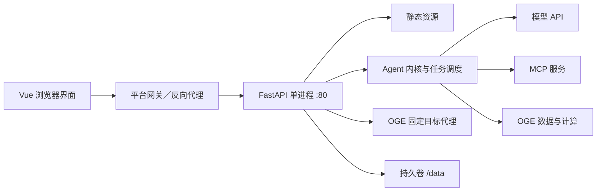

# 坤舆智枢 Web 架构

## 运行结构

浏览器运行 Vue 3、TypeScript、Vue Router Hash 路由、Pinia 和 TanStack Vue Query。基础 UI 使用 shadcn-vue 风格、Reka UI 与 Tailwind；地图沿用 MapLibre。组件使用 Vue 单文件入口与原生 Vue TSX，数据变换、事件投影和模型协议保持独立。

FastAPI 在单一进程中提供静态资源、`/api/v1` 业务 API、`/openge/api/` 固定目标代理和 MCP OAuth 回调。生产容器监听 `0.0.0.0:80`，不启动额外的前端 Web 服务。

## 目录职责

| 目录 | 职责 |
| --- | --- |
| `frontend/src/app` | 布局、路由、界面状态和会话恢复 |
| `frontend/src/components/ui` | 通用 Vue 基础组件 |
| `frontend/src/features` | 按业务组织的页面、组合函数、API 与纯数据处理 |
| `backend/src/kunyu/web` | 部署配置、实例会话、OGE 代理和公开 OAuth 回调 |
| `backend/src/kunyu/api` | HTTP 路由、输入输出和错误转换 |
| `backend/src/kunyu/application` | 工作区、会话及业务用例编排 |
| `backend/src/kunyu/domain` | 领域模型及业务约束 |
| `backend/src/kunyu/agent` | Agent 内核、运行循环、工具、插件与作用域 |
| `backend/src/kunyu/integrations` | 外部协议、地理计算、文件和子进程适配 |
| `backend/src/kunyu/persistence` | SQLAlchemy 仓储、事件与 schema 16 SQL 基线 |

## 实例身份与外部凭据

`KUNYU_ACCESS_PASSWORD` 控制实例访问。后端签发 12 小时有效的 HttpOnly、SameSite=Lax Cookie；HTTPS 下同时设置 Secure。退出及重启使相应会话失效。业务接口、事件流、附件、成果、瓦片和代理均要求实例会话。健康检查只返回运行状态；OAuth 回调由一次性 state 校验。

团队共享工作区、模型配置与 OGE 身份。OGE 密码和令牌由后端管理，AppKey 来自 `OGE_APP_KEY`。前端只通过同源接口访问，不持有平台令牌。

`KUNYU_PUBLIC_URL` 决定外部 Origin、Cookie 路径和 OAuth 回调地址。Hash 业务路由与相对静态资源允许应用挂载到 `/app/<应用标识>/`。网关必须正确处理前缀、事件流和下载。

## 生命周期与持久化

单进程调度器在启动时恢复持久运行状态，统一管理 Agent、排队任务、人工等待、子任务、MCP 和连接。SIGTERM/SIGINT 先设置关闭信号，使事件流停止，然后执行资源清理。容器留出 30 秒停止时间。

`KUNYU_APP_DATA_DIR` 显式指定服务器数据目录；容器固定使用 `/data`。数据库、工作区、附件、成果、技能保存在同一持久卷。设置页展示目录与容量，目录变更通过部署配置完成。

schema 15 桌面数据通过独立离线脚本复制为 schema 16；应用不在运行时隐式升级旧库。旧桌面架构留存于 [历史设计](develop/archive/桌面开发架构设计.md)。

## MCP 部署

OAuth 使用 `<公开应用地址>/api/v1/mcp/oauth/callback`，不监听本机临时端口。公开地址变更后需要重新登录。

stdio 命令在容器内、以应用 UID 运行。依赖程序应安装到扩展镜像；工作目录和资源必须显式挂载或放入镜像。基础容器不包含 Node.js，也不提供宿主机应用访问能力。

## 交付

多阶段 Docker 构建先生成 Vue 静态资源，再由 uv 按锁文件安装 Python 依赖。Linux amd64 镜像导出为 `kunyu-web.tar`。部署与离线运行步骤见 [Web 部署](develop/Web部署.md)。
